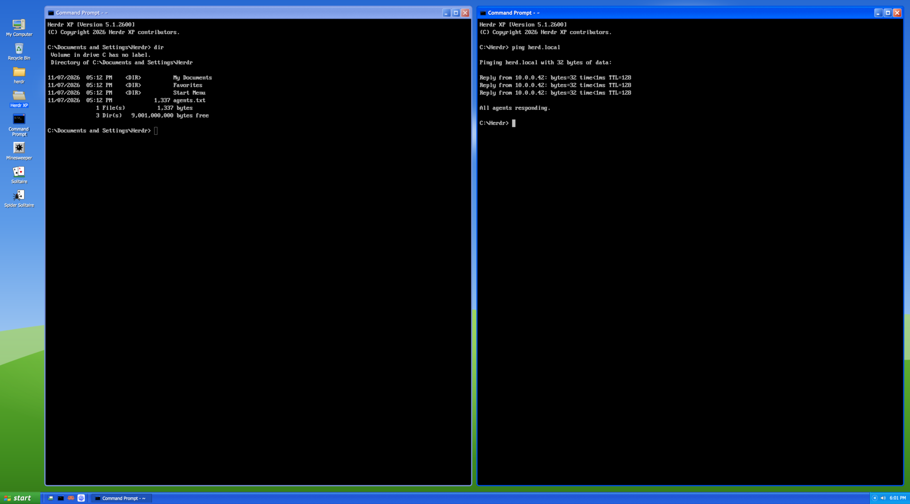

# Herdr XP

A Windows XP-style layout for the [Herdr](https://herdr.dev) desktop app: Luna-blue windows around every terminal, console-black terminals, a green start button, the two-column Start menu, Minesweeper, Solitaire, Spider Solitaire and FreeCell, and the Welcome screen.



## What's in it

- **Windows.** Every pane is an XP window. Drag a title bar onto another window's title bar or middle to swap the two, or onto the edge of its left, right, top or bottom to put the window beside it on that side. Minimize puts its tab away on the taskbar, Maximize zooms the pane, Close closes it. Right-click a title bar for the window menu, where Move steps the window left, right, up or down.
- **Terminals** look like XP's Command Prompt: black, light gray text, the 16 console colors and a bitmap font. They stay that way in light and dark.
- **Taskbar.** The start button, Quick Launch (Show Desktop, Command Prompt, your agents), and a button for each tab of the shown space. When more than five tabs are open, a program's tabs share one button with a count. Drag a tab's button along the taskbar to reorder your tabs. The notification area shows agents waiting for you, the connection (two monitors for Ethernet, radio waves for Wi-Fi, a red X when you're offline), the battery's charge on a laptop (with a plug while charging), the chevron that shows hidden icons, and the clock. Click the connection or the battery for its status. Right-click the taskbar for its menu.
- **Internet.** A real web browser in a window: Quick Launch's globe or Start's pinned Internet opens [terminal-browser](https://terminal-browser.com/) (`brew install --cask terminal-browser`) beside your window, or in its own tab when the shown one already has four windows. Its title bar reads like XP's ("Example Domain - Internet").
- **Folders and Changes.** An Explorer bar docks on the right: the Folders and Changes icons in Quick Launch (or Start ▸ All Programs ▸ Accessories) open it; its header switches between them and closes it. Folders shows the focused window's folder as XP's Explorer tree (click a file to preview it). Changes lists its Git changes in XP's Details view, shows the picked file's diff, and commits with a message.
- **Simulator.** With [Herdr Sim](https://github.com/wobsoriano/herdr-sim)'s `herdr-sim` mod installed, the Explorer bar also shows an iOS Simulator or Android emulator screen, as the Herdr Sim layout does. Open it with the phone in Quick Launch, Start ▸ All Programs ▸ Accessories ▸ Simulator, the bar's Simulator tab, or ⌘⇧S. Without the mod, none of these appear.
- **Start menu.** Pinned and often-used programs on the left, with All Programs ▸ Accessories ▸ Games and System Tools. On the right: My Spaces ▸, My Recent Tabs ▸, My Computer, Control Panel, Layouts ▸ (switch to another Herdr layout), Display Properties, Help and Support, Search and Run. At the bottom: Log Off and Turn Off Computer.
- **Desktop.** My Computer, Recycle Bin, each space as a folder (click to show it), Command Prompt and the Games folder. Games has its own icon, playing cards and a joystick, so it never looks like a space; click it for a window of the four games. Right-click an icon or the desktop for its menu.
- **Windows of their own.**
  - My Computer, which lists your spaces as drives next to XP's blue task pane.
  - The Recycle Bin.
  - Task Manager. End Task asks first, and an agent that needs you shows as "Not Responding".
  - Minesweeper (Beginner, Intermediate, Expert). It has seven-segment counters, cells that sink while held, chording on double-click or middle-click, Best Times, and F2.
  - Solitaire (Klondike, Draw One or Draw Three), with standard scoring and the bouncing cards when you win.
  - Spider Solitaire (one, two or four suits), with H for a hint.
  - FreeCell, which deals Microsoft's numbered games (Game #1 to #32000). It moves runs that fit your free space, sends safe cards home by itself, and has the king who looks toward your pointer.
- **The card games feel the same.** Drag cards to move them, or click a card and then click where it goes. Double-click or right-click sends a card home. Undo with Ctrl+Z or ⌘Z, and start a new game with F2.
- **Dialogs.**
  - Run starts a command in a new tab.
  - Log Off and Switch User go to the Welcome screen, where each of your layouts is a user: click one to switch to it.
  - Turn Off Computer offers Stand By, which minimizes; Turn Off, which quits Herdr while herdr-core keeps your terminals running; and Restart, which shows the boot screen.
  - Display Properties picks light, dark, or following your system.
  - About, and the Desktop Cleanup Wizard.
- **Quirks.** A boot screen the first time it shows, balloon tips from the tray ("Take a tour", the cleanup nag), and startup and shutdown chimes.
- **Light and dark.** The layout follows your system's appearance. Light is Luna with a daytime wallpaper. Dark keeps Luna's blue bars and turns menus, dialogs and Explorer dark, with a night wallpaper.

## Install

You need the Herdr desktop app (tested with 0.1.13) and Python 3.

```sh
git clone https://github.com/avihut/herdr-xp
cd herdr-xp
python3 scripts/install.py
```

With [mise](https://mise.jdx.dev), `mise run install` does the same and then checks the mod.

The script copies `layouts/winxp.json`, the two themes and `mods/winxp` into `~/.config/herdr-app` (or `$HERDR_APP_HOME`). If you have a `keys.json`, it adds Ctrl+Esc to open the Start menu there, unless you already use that key. Herdr treats an edited `keys.json` as yours and stops adding its new default shortcuts to it. The script backs the file up first.

Then switch to it with ⌘⇧L, or run:

```sh
herdr-app do layout.switch '{"name":"winxp"}'
```

Run the install again to update.

## Uninstall

```sh
python3 scripts/install.py --uninstall
```

This removes the layout, the themes, the mod and its key.

## Good to know

- **Fonts.** The UI uses Tahoma and Trebuchet MS when they're installed (macOS has both), and falls back to Verdana or DejaVu Sans otherwise. Terminals use PxPlus IBM VGA 8x16, which ships with Herdr's own Windows 98 layout.
- **Display Properties** changes Herdr's appearance setting (`appearance` in `settings.json`), which applies to every layout.
- **Art and sound.** All art and sounds are original: drawn as SVG and synthesized for this layout. No Microsoft assets are included.
- **Reference values.** Colors and sizes follow [XP.css](https://github.com/botoxparty/XP.css) and [winXP](https://github.com/ShizukuIchi/winXP), both MIT.

## License

[MIT](LICENSE)

## Optional pane names

With [Pane Rename](https://github.com/avihut/herdr-pane-rename) installed, Cmd+F2 or the title-bar context menu’s **Rename Pane…** opens the XP-styled name dialog. Names appear consistently in window titles, taskbar groups, drag previews, and Task Manager. Empty names restore XP’s automatic titles. The title-bar menu reads the optional capability manifest once when opening and hides Rename when unavailable. Terminal right-clicks use the rename menu when installed; Herdr falls back to its default menu if it is absent.

## Workspace groups

Parent and child spaces appear directly in the desktop folders and My Computer Explorer, using the layout’s native styling. Parents keep their own tabs and terminals and remain selectable. Expansion affects child spaces only; tabs stay in the normal tab bar. Relationships use the shared per-machine hierarchy. There is no extra hierarchy selector. On the desktop, a parent's child spaces show as a tree right under its folder, in a panel, each a small folder with its name; the [+]/[−] box before a folder's name (or its right-click menu) shows or hides them. Drag a space's folder up or down to reorder your spaces: a root folder among the root folders, a child space among its siblings. A white bar shows where it will land. This isn't XP's desktop, which has no tree, but it keeps every space one click away. My Computer's Explorer also browses them, with Back, Forward, Up, an address path, and Open this workspace. Games remains a separate desktop icon and folder.
