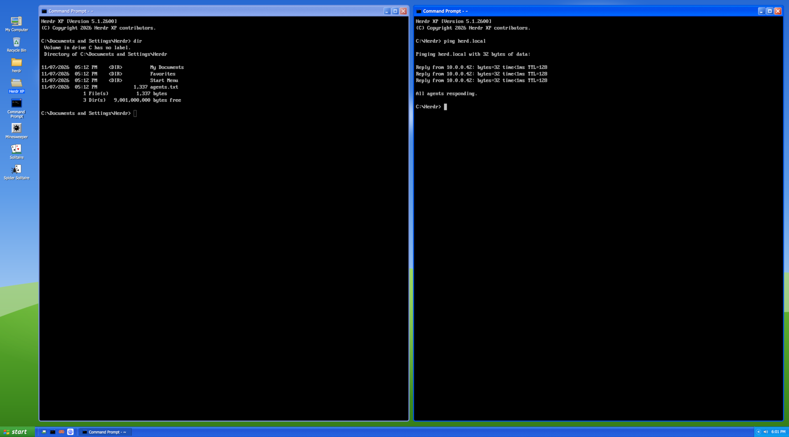

# Herdr XP

The whole Herdr window as a Windows XP desktop. A Luna-blue taskbar runs along the bottom, with a green start button and the two-column Start menu. A column of desktop icons sits over a wallpaper of a green hill under a blue sky (by day) or under stars (by night). Every pane is an XP window with a Luna title bar around a black Command Prompt. There are XP's games, Explorer windows, Task Manager, dialogs and the Welcome screen.

## What you see

Fonts are Tahoma 11 px for UI text and Trebuchet MS bold 13 px for titles, falling back to Verdana or DejaVu Sans. Terminals use PxPlus IBM VGA 8x16 at 16 px, which ships with Herdr's Windows 98 layout.

1. **Desktop column, 96 px, left.** Icons are 34 px, each with a white 11 px label carrying a 1 px dark shadow; the selected icon's label is on `#316ac5`. From the top: My Computer, Recycle Bin, one folder per root space (the shown space selected; a parent's [+]/[−] box sits before its label, and its expanded children follow in a panel, `#0000002e` with a `#ffffff33` border, radius 4, as 16 px folder rows indented 10 px per level, names on up to three lines), Command Prompt, Games. Games is the space folder with an ace of spades and a heart sticking out and a red-ball joystick in front (`img/games.svg`), so it never passes for a space. There is 40 px of room at the top for the macOS traffic lights at (12, 12).
2. **Windows, the rest above the taskbar.** The shown tab's panes sit 10 px apart, with 14 px of padding. Each has:
   - a 3 px frame (`border` theme color, `accent` when focused), radius 7;
   - a 30 px title bar: a 16 px icon, a bold white title with a `#0f1089` shadow, and three 21 px caption buttons (blue, blue, red-orange, white edge, radius 3);
   - the active bar in XP.css's gradient `#0997ff → #0053ee 8% → #0050ee 40% → #0066ff 88% … #003dd7 96%`;
   - an inactive bar in the same shape in faded blue.
3. **Taskbar, 30 px.**
   - Luna's gradient from the winXP clone, 16 stops, `#1f2f86` at the top to `#1941a5`.
   - A 100 px green start button with a rounded right end: the four-color flag and "start" in white Trebuchet bold italic 18.
   - Quick Launch between etched dividers.
   - Tab buttons, max 150 px, 22 px high, radius 2: `#3c81f3`, hover `#53a3ff`, pressed `#1e52b7`, with a light top-left edge and a dark right edge.
   - The notification area on the tray gradient (`#0c59b9 … #095bc9`), with a `#1042af` / `#18bbff` left edge: the chevron, agent counts, the connection, the battery, volume, the clock.
4. **Start menu, 380 × 448, above the start button.**
   - A 54 px banner (`#1868ce → #4791eb`) holds a 42 px user picture in a 2 px light frame and the user's name in 14 px bold.
   - An orange `#da884a` line fades out at both ends.
   - Left column: white, 190 px, 34 px rows with 30 px icons.
   - Right column: `#cbe3ff`, 26 px rows with 22 px icons, ink `#00136b`.
   - Rows highlight in `#2f71cd`; separators fade out at both ends.
   - A 36 px footer: Log Off and Turn Off Computer.
5. **Wallpaper.** The root background is `img/wallpaper-day.svg` or `img/wallpaper-night.svg`, `cover`.

Dark theme: the title bars, taskbar, start button and tray stay Luna blue. Menus, dialog faces, lists and the Explorer task pane go dark, and the wallpaper turns to night. Terminals are black in both themes.

## How it behaves

- **Agent status.** Every agent status appears on its pane's title bar and its tab's taskbar button:
  - working: a blue dot;
  - done: a green dot;
  - blocked: a red dot, the tab button turns orange, and a red count appears in the tray (click it to focus the agent);
  - idle: nothing.
- **Title bars.**
  - Press to focus the pane; double-click to zoom it.
  - Drag a title bar onto another window of the tab. Drop it on that window's title bar or middle and the two trade places. Drop it on the outer quarter of its left, right, top or bottom and the window goes beside it on that side. While dragging, a see-through copy of the window follows the pointer, and selection blue previews where it lands (all of the target, or the half it would take) with a label: Swap, Put Left, Put Right, Put Above, Put Below. Let go anywhere else, right-click or press Esc to leave everything where it was. Herdr's own pane grip is off.
  - Minimize settles the tab, Maximize zooms the pane, Close closes it.
  - Right-click, or click the icon, for Restore, Move ▸ Left/Right/Up/Down, Minimize, Maximize, Split Right, Split Down and Close.
- **Taskbar.**
  - Click a tab button to show its tab; click the shown one to settle it.
  - Drag a tab button along the taskbar to reorder the tabs (`tab.move {id, index}`). Past 4 px a press is a drag: the button dims and a 3 px white bar marks where it lands, before or after the button under the pointer (whichever half). A program's group button takes drops too (before its first tab or after its last) but doesn't drag. Dragging off the taskbar cancels, since a block hears no release outside itself. `taborder.js` works out the landing position.
  - With more than five tabs, tabs of one program share a button ("3 Claude Code ▴") that opens a list.
  - The connection icon follows the Mac's primary network every 10 s: two monitors for Ethernet (the tooltip has the link speed), a monitor with radio waves for Wi-Fi, a red X when there's none. Click it for its status.
  - On a computer with a battery, an upright battery cell shows the charge: green, amber at 25% and under, red at 10% and under, and a plug on AC power. The tooltip reads like XP's ("Fully charged (100%)", "2 hr 5 min (64%) remaining"); click it for the Power Meter.
  - The chevron shows working and done counts and Safely Remove Hardware.
  - Right-click the taskbar for XP's taskbar menu.
- **Start menu.**
  - Opens on a press of the start button, or Ctrl+Esc.
  - Hover a row with ▸ to open its submenu to the right: All Programs, My Spaces, My Recent Tabs, Layouts.
  - A choice closes the menu and acts.
- **Desktop.**
  - One click opens an icon. Right-click an icon for its menu: a space's has Open, New Tab Here, Rename, and Delete, which asks first.
  - Games opens the Games folder, an Explorer window (`games` role) with the four games as tiles: FreeCell, Minesweeper, Solitaire, Spider Solitaire, each with a line about it. One click starts one. Its task pane has Play a random game. Its menu has Open, then each game.
  - Right-click the desktop for Arrange Icons By, Refresh, New ▸ Space or Tab, and Properties.
- **Internet.** `terminal-browser` (a real browser drawn in a terminal; `brew install --cask terminal-browser`) runs in a pane: Quick Launch's globe, Start's first pinned item (Internet, "Web browser") and the `winxp.internet` key command call `openBrowser` in `kit.js`, which splits right of the focused window in the shown tab (`focused().tab`; `PaneInfo.focused` is true for one pane in every tab, so it can't find the shown tab), or opens a tab named Internet when no window has focus. `isBrowser` recognizes it, so its windows get the globe (`img/internet.svg`) and XP's title, "<page> - Internet".
- **Office Assistant.** `clippy.js`. The desktop draws the paperclip itself (`Assistant.element`), over the bottom of its strip, straight on the wallpaper: a floating block would get Herdr's own panel around it. Its balloon is a frameless `window` overlay above it (the clippy role), opened, swapped and closed by `Assistant.sync` on each desktop render (and a 2 s look at `agents()`). It ports the Windows 98 layout's assistant: `agents()` that are blocked or done and not focused get a balloon (Take me there runs `agent.focus`; Not now puts it off until that status changes), and a click shows a tip (`sounds/clippy.mp3`). The balloon is Office XP's: `#ffffe1`, 8 px corners, blue bullets, the tray balloon's tail. State is shared: `winxp.clippy` ("off" hides it: its balloon, Display Properties' check box; Accessories ▸ Office Assistant sets it back on), `winxp.clippy.tip`, `.dismissed`, `.closed`. The paperclip (`img/clippy.svg`, `clippy-sm.svg`) is our own drawing in the XP-era style.
- **Explorer bar.** A docked panel on the right: the layout's `panel` column (hidden, 380 px, 280 to 900 px wide; it sits with `main` in the `work` row, the one resizable row, so only its left edge drags and the desktop strip stays put) holds the `panelbar` header (28 px, the task pane's blue header gradient: Folders and Changes as tabs, the active one bold on a light chip, and the Luna close button) over the `panel-body` stack of two XP-drawn bars, not Herdr's stock `files` and `changes` mods:
  - `folders`: the focused window's folder as XP's Explorer tree, 18 px rows, 19 px per level, gray guide lines with elbows, [+]/[-] boxes, 16 px folder and `doc` icons, Tahoma 11; a click selects (XP blue), a folder opens, a file opens a read-only preview with a Back button and an address field; Git marks A/M/D/U after names.
  - `changes`: a summary strip ("7 files changed", +N −M), Details view headers (Name, In Folder, Changes) on XP's header gradient, rows with a colored status badge (A green, M orange, D/U red), the picked file's diff (line numbers, green and red rows, hunk headers on the face color), and a commit box (XP text field and button: `git add -A` then `git commit -m`).
  - `repo.js` reads the folder and Git for both, layout-neutral; both follow the focused pane and refresh on `watchFolder` and every 10 s. `watch.js` keeps that to one watch loop per bar and folder, and watches only folders inside a Git repository, never home or above. A closed bar sleeps until it shows again. `mise run test` covers both.
  - A third child, `herdr-sim`, is Herdr Sim's own mod (`{ mod: "herdr-sim", props: { frames: "panel" } }`), as in the Herdr Sim layout. `hasSim()` (`kit.js`) checks `mods/herdr-sim/mod.json` once per copy, so the Simulator tab, Quick Launch's phone (`img/phone.svg`), Accessories ▸ Simulator and ⌘⇧S (`winxp.simulator`, from the repo's `keys.json`) appear only when the mod is installed.
  - Quick Launch's Folders and Changes icons, and Accessories ▸ Folders and Changes, toggle it (`togglePanel` in `kit.js`: `layout.select` the stack's child, `layout.show`/`layout.hide` the panel, read back from `layout()`, plus a `winxp.panel` shared write so every copy re-renders); a Quick Launch icon looks pressed while its bar shows.
- **Wallpaper.** When the theme turns dark or light, the desktop role runs `layout.set` with the other wallpaper. Herdr caches a background by path, so rewriting the file isn't enough.
- **Welcome screen** (Log Off ▸ Log Off or Switch User). Every layout is a user, the shown one marked. Clicking another switches to it; clicking the shown one logs back on with the startup chime.
- **First show.** The boot screen (logo, three blue blocks sliding through a bar) shows for 3 s. Then comes the startup chime and the "Take a tour of Herdr XP" balloon.
- **Desktop Cleanup Wizard nag.** Once a day, after 30 minutes on the layout, as a balloon.

## Built from

- **Files.**
  - `layouts/winxp.json`.
  - `themes/winxp.json` (light) and `themes/winxp-dark.json`. Both have black terminals with the 16 console colors; they differ in their panel colors.
  - `mods/winxp`, one mod with roles.
  - `keys.json`: `"layout:winxp": {"ctrl-escape": "winxp.start", "cmd-shift-s": "winxp.simulator"}`.
- **Layout tree.**
  - A root column with the theme pair, the wallpaper, `ui_font` Tahoma, the VGA terminal font, `titlebar: "none"` and `traffic_lights`.
  - A row containing `desktop`, a 96 px block with `window_drag`, and `main`, the `{ "tab": "active" }` block whose pane header is the `window` role. `main` has `"movable": false`, which hides Herdr's pane grip; the title bars move windows instead.
  - `taskbar`, a 30 px block with `window_drag`.
- **Roles** (props `{ role }`):
  - layout roles: `taskbar`, `desktop`, `window`;
  - popups: `start` and `menu` (a cascading menu: `{ items, parents }`);
  - dialogs: `dialog` (`kind` run, logoff, turnoff, confirm, display, about, cleanup), `boot`, `welcome`;
  - an overlay window for `balloon`;
  - a full-window, frameless popup for `panedrag` (`{ pane, title, bars, press }`), the layer that follows a dragged title bar;
  - helpers without a role: `battery.js` (`pmset -g batt`) and `network.js` (`scutil --nwi`, `networksetup -listallhardwareports`, `ifconfig`), which the taskbar polls;
  - windows with `key` `winxp-<role>`: `mycomputer`, `bin`, `games` (Explorer windows), `taskman`, `mines`, `sol`, `spider`, `freecell`.
- **The card games** share `cardtable.js`, a `CardTable` class that owns the table: drag and drop, click to move, double-click and right-click auto-moves, Undo, F2, the menus, the status bar, table messages, a hint flash and the bouncing win. Each game extends it with its rules (`setup`, `layout`, `canPick`, `canDrop`, `moved`, `clickPile`, `autoMove`, `isWon`, `status`). `cards.js` draws the cards.
- **Commands.**
  - `tab.new`, `tab.select`, `tab.settle`, `space.select`, `space.new`, `space.rename`, `space.close`;
  - `pane.focus`, `pane.zoom`, `pane.close`, `pane.split`, `terminal.kill`, `agent.focus`;
  - `layout.switch`, `layout.set`, `app.settings`, `app.palette`, `app.help`, `app.quit`, `window.minimize`.
- **Herdr functions.** `knownAgents()` lists the installed agents, `window.bounds()` positions balloons, `playSound` plays the chimes, and `readTextFile` / `writeTextFile` let Display Properties set `appearance`.
- **Art.** All of it is original. The `img/` SVGs are drawn by hand. The `sounds/` MP3s are synthesized sine chords (ffmpeg). Colors and sizes come from XP.css and the winXP React clone (both MIT).

## Watch out

- A header mod can't start Herdr's pane drag, and gets mouse moves only while the pointer is over it. So `panedrag.js` has the title bar open a full-window popup once the press moves 4 px or leaves the bar. The popup gets the moves and the release wherever they happen. No API reports a pane's position: each title bar records its own box from `on_mouse_down_out`, which gives an element its bounds even for a press outside it. Windows trade places through `pane.swap`, which acts on the focused pane and its neighbor. To swap with a window further away, swap along neighbors and back. Only take a step where one side has exactly one neighbor in that direction.
- A popup gives its content no height. The drag layer sizes its root to the window, or it is a 0 px strip and the drag does nothing.
- No command puts a pane beside another. An edge drop parks the window's terminal (`terminal.park`: the pane goes, the program keeps running), focuses the target, and gives the terminal a pane again with `terminal.keep {place: right | down}`. For left or above it then swaps once. Both acknowledge first and apply later, so each step waits until `panes()` shows the change. The taskbar runs this from shared `winxp.place`, because the layer may close mid-move. A mod pane has no terminal, so it can only trade places.
- Copies of a mod don't share module state. Anything one copy must hand another (the title bar boxes, the drag) goes through `shared`.
- `h_flex()` centers its children vertically. Two-column bodies (the Start menu, Explorer) must be `div().flex().flex_row()`, or the columns float in the middle.
- A popup doesn't give its content a definite height. Give the Start menu root an explicit `.w()` / `.h()`, or it shrinks to its rows and leaves a gap above the taskbar.
- Gradients have two stops. Luna's bars are stacks of bands, made by a `stops()` helper from CSS-style stop lists.
- `InputState` and `Input` come from `gpui-base`, not `gpui-kit`. There is no `line_clamp`; use `max_h` with `overflow_hidden`.
- Install a mod by swapping its folder in whole (stage it, then rename). Copying file by file reloads it once per file, and after enough reloads Herdr's runtime for the mod runs "out of memory" until Herdr.app restarts.
- A bar's copy stays alive once shown, and its timers run while it's closed. `watchFolder` can't be cancelled, and on macOS it watches the whole tree, ignored folders included. A watch loop started on every refresh piles up for hours. That is the main suspect for the 2026-11-08 "Null\"null\"" errors, which are what the runtime reports when it runs out of memory.
- Herdr's CLI can't send a mod command. To look at a role, open it as a mod pane: `herdr-app do tab.new --mod winxp --props '{"role":"mines"}'`.
- Overlay windows can't minimize; their Minimize closes them.
- The Recycle Bin is always empty, since Herdr closes things for good.

## Done when

- `herdr-app check mods/winxp` passes, and `herdr-app status` shows no errors with the layout shown, in light and in dark.
- The wallpaper follows the theme within a second of switching the system appearance.
- Start ▸ Layouts lists each layout once, marks Windows XP, and switches.
- Minesweeper opens a cell on the first click without a mine. Solitaire moves a card to the foundation on a double-click, and a dragged card lands where it's dropped. Spider puts away a finished King-to-Ace run. FreeCell Game #1 deals J♦ 2♦ 9♥ J♣ 5♦ 7♥ 7♣ 5♥ across its first row.
- Run with `htop` opens a tab running htop. Log Off ▸ Switch User shows the Welcome screen with every layout.

## Optional pane names

With [Pane Rename](https://github.com/avihut/herdr-pane-rename) installed, Cmd+F2 or the title-bar context menu’s **Rename Pane…** opens the XP-styled name dialog. Names appear consistently in window titles, taskbar groups, drag previews, and Task Manager. Empty names restore XP’s automatic titles. The title-bar menu reads the optional capability manifest once when opening and hides Rename when unavailable. Terminal right-clicks use the rename menu when installed; Herdr falls back to its default menu if it is absent.

## Primary space hierarchy

Parent and child spaces appear directly in the desktop folders and My Computer Explorer, using the layout’s native styling. Parents keep their own tabs and terminals and remain selectable. Expansion affects child spaces only; tabs stay in the normal tab bar. Relationships use the shared per-machine hierarchy. There is no extra hierarchy selector. On the desktop, a parent's child spaces show as a tree right under its folder, in a panel, each a small folder with its name; the [+]/[−] box before a folder's name (or its right-click menu) shows or hides them. This isn't XP's desktop, which has no tree, but it keeps every space one click away. My Computer's Explorer also browses them, with Back, Forward, Up, an address path, and Open this workspace. Games remains a separate desktop icon and folder.
